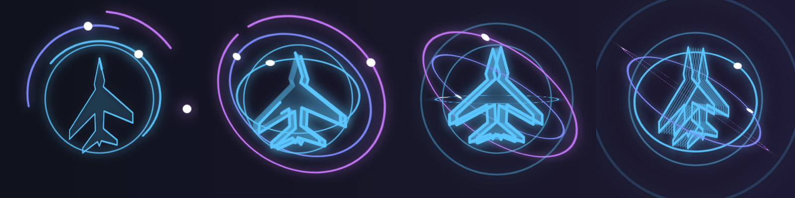

# VoicePilot

마우스·키보드 없이 **음성만으로 컴퓨터를 조작**하는 로컬 음성 제어 도우미입니다.
음성 인식은 [faster-whisper](https://github.com/SYSTRAN/faster-whisper)로 **내 컴퓨터에서만** 처리하며, 녹음한 소리를 외부로 보내지 않습니다.

> 현재 버전(0.1)은 **웨이크워드 + 창/모니터/브라우저 탭 전환, 앱 실행·숨기기, 클릭·스크롤, 웹 검색**까지 동작합니다. 대상 OS는 macOS입니다.
> 설계와 이후 계획은 [docs/DESIGN.md](docs/DESIGN.md)를 보세요.

## 할 수 있는 것

| 이렇게 말하면 | 동작 |
|---|---|
| "파일럿" → (효과음) → "클로드보드로 넘어와" | ClaudeBoard 창에 포커스, 커서를 그 창 가운데로 이동 |
| "파일럿, 크롬 화면에서 구글지도 열어줘" / "크롬에서 npm 열어줘" | 크롬의 **탭 제목과 주소(URL)**(가려진 탭 포함)에서 찾아 그 탭을 선택하고 창을 앞으로 가져옴 |
| "파일럿, 오른쪽 크롬 화면에서 npm 열어줘" | 오른쪽 모니터의 크롬 창들 중에서 고름 |
| "파일럿, 에어비앤비 열어줘" | 앱 이름이 아니어도 열린 창·탭 제목에 있으면 그 곳으로 이동 |
| "파일럿, 크롬 보여줘" | 한 번에 말해도 됩니다. 크롬이 꺼져 있으면 실행해서 보여 줍니다 |
| "파일럿, 크롬 열어줘" / "실행해줘" / "켜줘" | 같은 동작: 창이 있으면 이동, 어느 모니터에도 창이 없으면 앱을 실행 |
| "파일럿, 왼쪽 화면" / "오른쪽 모니터로 넘어와" | 해당 모니터의 맨 앞 창에 포커스, 커서를 모니터 가운데로 이동 |
| "파일럿, 2번 모니터" / "두 번째 화면으로 넘어와" | 왼쪽부터 센 번호로 모니터 선택 |
| "파일럿, 다음 화면" | 지금 화면의 오른쪽 모니터로 (끝이면 처음으로) |
| "파일럿, 오른쪽 화면 크롬 열어줘" | 오른쪽 모니터에 있는 크롬 창으로 포커스 (그 모니터에 없으면 실패) |
| "파일럿, 포크 숨겨줘" / "크롬 내려" | 그 앱의 창을 모두 숨김 (다시 보려면 "포크 열어줘") |
| "파일럿, 클릭" / "더블클릭" / "우클릭" | 지금 커서 위치를 클릭 |
| "파일럿, 스크롤 내려" / "위로 스크롤" | 커서가 있는 창을 10줄 스크롤 |
| "파일럿, 크롬 열어서 후쿠오카 여행지 추천 찾아줘" | 크롬(꺼져 있으면 실행)에서 구글 검색 결과를 새 탭으로 엽니다 |
| "파일럿, 우측 화면 크롬에서 후쿠오카 여행지 검색해줘" | 오른쪽 모니터의 크롬 창에서 검색 탭을 엽니다 (그 모니터에 크롬 창이 없으면 실패) |
| "파일럿, 후쿠오카 맛집 알아봐줘" / "도쿄 날씨 크롬으로 검색해줘" | 앱을 말하지 않으면 기본 브라우저로 검색합니다 |

검색 동사는 찾아줘·찾아봐줘·검색해줘·알아봐줘·알려줘·서치해줘 등을 알아듣고, "열어서/켜서/에서/으로"로 앱과 이어 말해도 됩니다.

말은 한 번에 이어서 해도("파일럿, 크롬 열어서 …"), "파일럿" 하고 잠시 쉬었다가 해도 됩니다. 호출어 뒤 8초 동안 기다리며, 말하는 중에는 시간이 흐르지 않습니다. 문장 중간에 쉬어서 앞부분("크롬에서")이 모르는 명령이 되면 6초 안에 이어 말한 뒷부분과 합쳐서 다시 해석합니다.

"파일럿"만 부르면 효과음과 함께 **화면 가운데(마우스 커서가 있는 모니터)에 3D 비행기 로고 애니메이션**(회전하는 고리 3개가 입체 선 비행기를 감쌉니다)이 나타납니다. 명령을 말하거나 시간이 지나면 사라집니다. 끄려면 `config/settings.yaml`에서 `overlay: false`.



*"파일럿"을 부른 뒤 0.4초, 1.0초, 1.8초, 2.8초 장면 (실제로는 화면 가운데에 투명 배경으로 떠서 계속 움직입니다)*

띄어쓰기나 어미가 조금 달라도("클로드보드로 넘어와요", "넘어가") 가장 비슷한 명령을 찾습니다.

## 설치 (macOS)

필요한 것: macOS 12 이상, Python 3.10 이상 (Apple Silicon 권장)

```bash
git clone https://github.com/HamHyunJun/VoicePilot.git
cd VoicePilot

python3 -m venv .venv
source .venv/bin/activate
pip install -e .
```

`sounddevice`가 마이크를 열지 못하면 Homebrew로 PortAudio를 설치하세요: `brew install portaudio`

### 음성 인식 모델 (처음 한 번만 인터넷 필요)

처음 실행할 때 Whisper 모델(기본 `small`, 약 480MB)을 내려받아 `~/.cache/huggingface`에 저장합니다.
그 다음부터는 인터넷 없이 동작합니다. 완전히 오프라인으로 쓰려면 모델을 받아 둔 뒤 `config/settings.yaml`에서 다음처럼 설정하세요.

```yaml
stt:
  model: small
  local_files_only: true   # 인터넷 접속을 시도하지 않음
```

호출어("파일럿")는 아주 작은 `tiny` 모델(`stt.wake_model`)이 먼저 빠르게 확인하고, 명령은 `model`이 인식합니다. 명령 인식이 느리면 `model: base`로 낮춰 보세요(0.5초대, 정확도는 낮아집니다).

모델 크기는 속도와 정확도의 균형입니다. 느리면 `base`, 인식이 부정확하면 `medium`을 써 보세요.

빠른 반응을 위해 대기 중에는 짧은 발화(1.2초 이하)를 0.5초만 쉬어도 끊습니다("파일럿"만 부르면 약 0.7초 안에 반응). 긴 문장은 1초까지 기다립니다. `beam_size`(기본 3)를 1로 낮추면 인식이 더 빨라지고 정확도는 조금 낮아집니다.

### macOS 권한 설정

시스템 설정 → 개인정보 보호 및 보안에서 **VoicePilot을 실행하는 앱**(터미널, iTerm, VS Code 등)에 아래 권한을 주세요.

| 권한 | 이유 |
|---|---|
| 마이크 | 음성 입력 |
| 손쉬운 사용 | 특정 창을 맨 앞으로 가져오기 |
| 화면 기록 | 다른 앱의 창 제목 읽기 (없으면 앱 이름으로만 찾습니다) |

권한을 바꾼 뒤에는 터미널을 다시 실행해야 적용됩니다.

## 실행

```bash
voicepilot                 # 마이크로 음성 제어 시작 (python -m voicepilot 과 같음)
voicepilot --text          # 마이크 대신 키보드로 문장 입력 (음성 인식 없이 동작 확인)
voicepilot --text --dry-run  # 실제 창을 건드리지 않고 명령 매칭만 확인
voicepilot --list-windows  # 인식 가능한 창 목록
voicepilot --list-monitors # 모니터 번호 확인 (왼쪽부터 1번)
voicepilot --list-devices  # 마이크 장치 목록
voicepilot -v              # 인식된 문장 등 자세한 로그
voicepilot --install-login-item    # 로그인할 때 자동 실행 등록 (터미널 없이 동작, 로그: ~/Library/Logs/VoicePilot.log)
voicepilot --uninstall-login-item  # 자동 실행 해제
```

로그인할 때 자동으로 실행하는 LaunchAgent로 등록하면 터미널을 켜 두지 않아도 됩니다. 이때 마이크·손쉬운 사용 권한은 터미널이 아니라 실제 실행 파일(`.../Python.framework/.../Python.app`)에 줘야 합니다. 에이전트 재시작: `launchctl kickstart -k gui/$(id -u)/com.voicepilot.agent`

처음에는 `voicepilot --text`로 "파일럿 크롬 보여줘"처럼 입력해 창 전환이 되는지 확인한 뒤, 음성 모드로 실행하는 것을 권합니다.

## 명령 추가하기 (코드 수정 없이)

[config/commands.yaml](config/commands.yaml)을 고치면 됩니다.

```yaml
commands:
  - id: focus_window
    action: focus_window
    patterns:
      - "{target} 넘어와"     # {target}이 말한 이름이 됩니다. 끝의 조사(로/으로/에)는 자동으로 떼어 냅니다.
      - "{target} 띄워줘"     # 새 문장 추가

aliases:
  # 한글로 부르는 이름 → 실제 앱 이름 또는 창 제목
  클로드보드: ["ClaudeBoard", "Claude Board"]
  옵시디언: ["Obsidian"]     # 새 별칭 추가
```

- 패턴 안에 `(찾아줘|검색해줘)`처럼 쓰면 선택지로 보고 문장 여러 개로 풀어 줍니다(`{슬롯}`은 그대로). 너무 많이 섞으면 느려지니 필요한 것만 넣으세요.
- 창 제목은 영어인데 한글로 부르고 싶으면("구글지도" → Google Maps, "에어비앤비" → Airbnb) `aliases`에 연결하세요. 창 제목은 손쉬운 사용 권한으로 읽으며, 크롬 계열 브라우저(Chrome, Brave, Edge, Chromium)는 모든 탭의 제목과 주소를 읽습니다("깃허브" → 주소에 github.com이 있는 탭). 처음 쓸 때 시스템 설정 → 개인정보 보호 및 보안 → **자동화**에서 허용해야 할 수 있습니다. Safari는 아직 탭 전환을 지원하지 않습니다.
- 창 이름을 한글로 부를 때는 `aliases`에 실제 앱 이름(`voicepilot --list-windows`로 확인)을 연결해 주세요.
- 현재 지원하는 동작: `focus_window`(`position` 지정 시 그 모니터의 창만, `launch_if_missing`이면 창이 없을 때 앱 실행), `focus_monitor`, `hide_window`(`target`), `launch_app`(`target`), `web_search`(`query`, 선택 `app`·`position`: 그 모니터의 앱 창에서 연다), `click`(`button`: left/right, `count`), `scroll`(`direction`: up/down) (`args`의 `position`: left/right/center/main/next/prev, 또는 `{index}` 슬롯)

설정 파일을 따로 두고 싶으면 `config/settings.yaml`을 복사해 고친 뒤 `voicepilot --config 내설정.yaml`로 실행하세요.

## 안 될 때 확인하기

로그(`~/Library/Logs/VoicePilot.log`, 터미널 실행이면 화면)에서 Whisper가 실제로 적은 문장을 볼 수 있습니다.

| 로그 | 뜻 |
|---|---|
| `🗣 문장` + `✅` | 인식되어 실행됨 |
| `🗣 문장` + `⚠️ 모르는 명령이에요` | 인식은 됐지만 명령 사전에 없음 → `commands.yaml`에 문장 추가 |
| `…호출어 없이 들린 말(무시): 문장` | 호출어("파일럿")가 안 들려서 무시됨 |
| 아무 줄도 없음 | 호출어가 인식되지 않음. `voicepilot -v`로 인식 결과 확인 |

앱 이름을 Whisper가 다르게 적으면("크롬"→"크롭") `aliases`에 그 표기를 추가하세요.

## 구조

```
voicepilot/
  audio/        마이크 입력, 발화 구간 분리(VAD)
  stt/          로컬 음성 인식 (faster-whisper)
  wakeword.py   호출어 탐지
  assistant.py  대기/듣기 상태 기계
  commands/     YAML 명령 사전, 유사 문장 매칭
  actions/      동작 실행 (창·모니터 대상 해석)
  platform/     OS 조작부 — base.py(인터페이스), macos.py, dummy.py(테스트용)
  feedback.py   효과음·콘솔 알림, 호출 시 오버레이(platform/macos_overlay.py)
config/         settings.yaml, commands.yaml
```

명령 인식부는 `platform/base.py`의 `DesktopController` 인터페이스만 사용합니다.
Windows/Linux를 지원하려면 이 인터페이스를 구현한 파일을 추가하고 `platform/__init__.py`의 `create_controller()`에 등록하면 됩니다.

## 테스트

```bash
pip install -r requirements-dev.txt
python -m pytest
```

음성 모델이나 마이크 없이 실행되며, 웨이크워드 탐지·명령 매칭·창/모니터 선택·상태 전환·발화 분리를 검사합니다.
macOS에서는 pyobjc로 실제 모니터·창 목록을 읽는 테스트도 함께 실행됩니다.

## 알려진 제한

- 웨이크워드는 음성 인식 결과에서 찾는 방식이라, 말할 때마다 Whisper가 동작해 CPU를 씁니다. 이후 경량 탐지기로 교체할 예정입니다.
- 한글 이름과 영어 앱 이름은 별칭(`aliases`)이 있어야 연결됩니다.
- 전체 화면 앱이 있는 다른 Space의 창은 목록에 나오지 않습니다.
- 낯선 지명·고유명사는 Whisper가 잘못 적을 수 있고, 검색은 적힌 그대로 합니다. 자주 쓰는 말은 `stt.initial_prompt`에 넣어 두면 잘 맞습니다.
- 브라우저 탭 전환은 크롬 계열만 됩니다. 검색 엔진은 구글로 고정입니다(`actions/executor.py`의 `_SEARCH_URL`).

## 다음 단계

받아쓰기·엔터·복사/붙여넣기·창 최소화/최대화, 인식한 명령을 오버레이에 표시, 메뉴 막대 아이콘 순으로 추가합니다. 자세한 계획은 [docs/DESIGN.md](docs/DESIGN.md#6-단계별-계획)에 있습니다.
